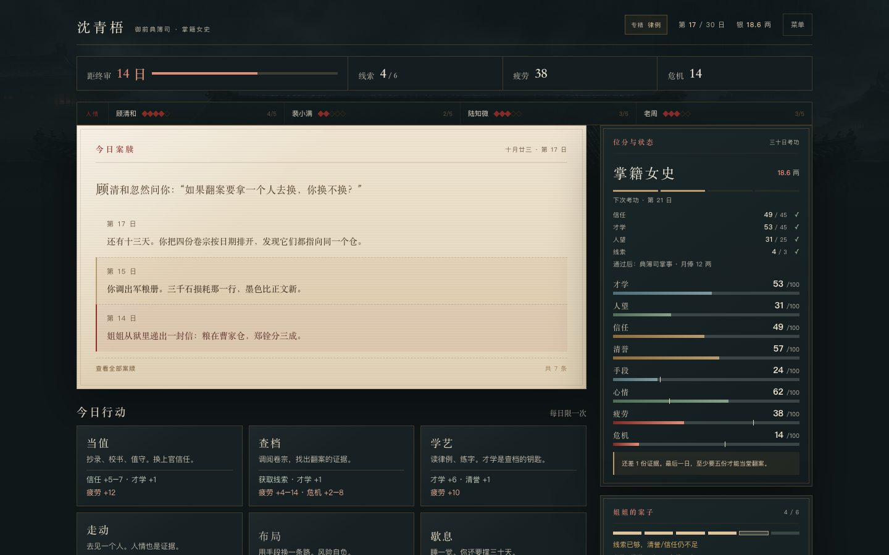
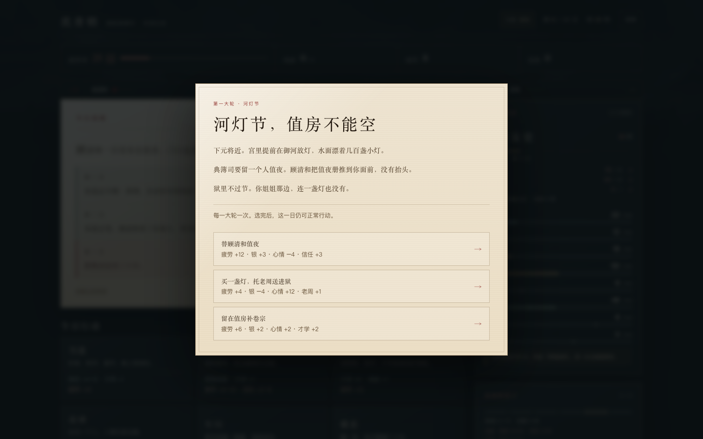
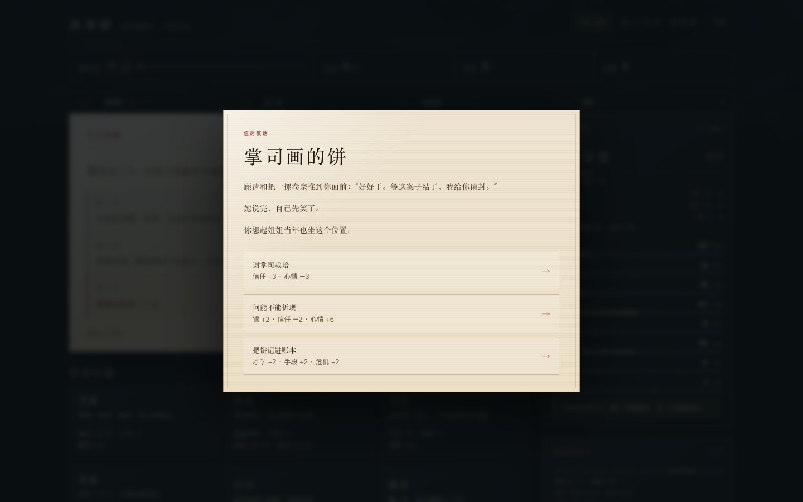
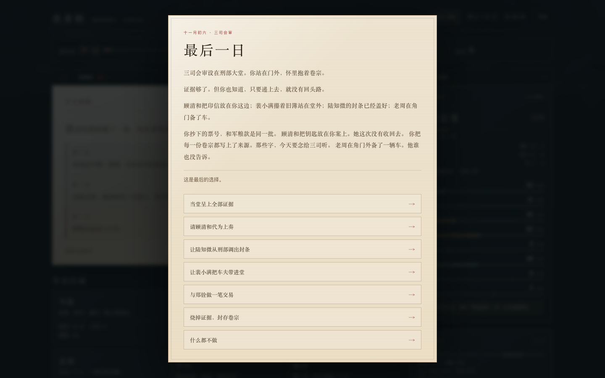

# 御前女官 · 三十日翻案录

一个单页、无依赖的古代文字游戏。你是刚入宫的抄录女史沈青梧，姐姐沈兰因被诬“私改军粮账册、盗卖官粮”，三日后秋决。典簿司掌司顾清和给了你三十天，和一支姐姐用过的笔。

三十天内，你要在当值、查档、学艺、走动、布局、歇息之间分配每一天，凑齐至少五份能当堂翻案的证据。

**无恋爱线。核心关系是姐妹、上官、同僚，以及一份被改过的档案。**



改版采用原创雨夜宫廷场景、浅色案卷和墨青状态栏。行动卡显示预计收益、消耗或解锁条件。页首汇总倒计时、线索、疲劳和危机，位分面板显示八项属性与关键阈值。

**本次优化（v1.1）：**

- 顶栏显示玩家姓名、所属衙门与当前位分，不再只有机构名。
- 考功条件改为可计算清单：`信任 18 / 25 ✗`，并显示通过后的位分与月俸。
- 呈证条件直接显示：有效线索 / 5、清誉 / 50、代奏信任 / 60、危机 / 85。
- 四个人物关系移到首屏“人情”条，点名字可看角色、效果与下一档解锁。
- 案牍只显示最近三条（手机两条），不再裁在半句话上；点“查看全部案牍”看全部记录。
- 结局页新增“本局复盘”：本局达成、触发条件、差在哪、下一局建议。

**本次新增（v1.2）：**

- 开局强制五选一专精：律例、算学、文牍、人情、验伪。每门有查档捷径、一次性绝活和不同的终局阈值。
- 第 7 / 14 / 21 / 28 日各有一条固定中盘事件，替代纯随机节奏；选择会改变线索、关系、危机或后面能走的路。
- 呈证条件不再固定：律例提高清誉门槛但多算一份线索，人情降低代奏信任门槛，验伪提高危机上限，算学在两账齐备时多算一份。
- 顶栏新增专精徽记，点开可看被动、捷径是否用过、以及一次性绝活。

**本次新增（v1.4）：**

- 30 日切成 5 个大轮，每轮一次节庆事件：第 6 日河灯节、第 12 日谢冬宴、第 18 日尝新礼、第 24 日祭仓、第 29 日守冬。
- 每次节庆 3 个选择，都会结算疲劳、银两、心情，部分选择还影响信任、人望、清誉、危机和人物关系。
- 节庆不额外消耗行动：选完后这一日仍可正常当值、查档或布局；每个节庆只触发一次。



**本次新增（v1.5）：**

- 新增 5 条“御前社畜”日常梗事件：掌司画的饼、三更的卷宗、同僚甩锅、考功前的暗示、姐姐的牢饭。
- 每条 3 个选择，选项有明确收益/代价，也会写进案牍；它们和主线共用同一个随机事件池，不额外占行动。
- 这 5 条事件用于首图与短视频切片：`docs/preview-pie.png` 是“掌司画的饼”的真实游戏画面。



**本次新增（v1.3）：**

- 四名 NPC 各有两段关系弧（关系 2 / 关系 4），不是好感奖励，而是会改变行动结果、可用的终局路线和结局正文。
- 四条固定节点的选择写入 `marks`；终局会逐条回响（你烧了信、收了银票、抄了调令、翻过档案库的窗）。
- 终局选项按关系立场解锁：顾清和可代奏，陆知微可调封条，裴小满可带车夫；老周会在角门备车。
- 第 30 日进入终局时自动保存 `pre_finale` 快照；结局页可点“回到终局前”，试另一条终局选择。



---

## 快速开始

### 方式一：直接打开单文件

双击 `御前女官.html`，或拖进浏览器。

- 单文件已内联 CSS、JS 与场景图，不需要联网、不需要安装。
- 存档在浏览器 `localStorage`。单文件另存到新位置或改用本地服务器时，浏览器可能为它分配独立存档。
- 推荐 Chrome / Edge / Safari 最新版。

### 方式二：开发模式

```bash
cd 御前女官-前端改版
python3 -m http.server 8765
# 打开 http://127.0.0.1:8765/
```

`index.html` + `style.css` + `game.js` 是拆分源码，方便改文案、调数值、加事件。

---

## 玩法

### 一回合 = 一日 = 一个行动

游戏从第 1 日到第 30 日，共 30 个行动。每个行动结束后进入下一日；第 30 日行动结束，进入三司会审终局。

六个行动：

| 行动 | 作用 | 主要代价 |
|---|---|---|
| 当值 | 信任、才学、清誉 | 疲劳 +12 |
| 查档 | 调阅六份卷宗之一 | 疲劳 +10~14，危机上升 |
| 学艺 | 才学 | 疲劳 +10 |
| 走动 | 人望、关系，可能直接得到线索 | 银 −2，疲劳 +8 |
| 布局 | 用手段换机会，或降危机 | 银/危机/疲劳，伪造失败即终局 |
| 歇息 | 疲劳 −32，心情 +8 | 消耗一日 |

> 疲劳 ≥75 时效率减半；疲劳到 100 会“灯枯”。心情 <30 时效率也会下降。

### 五门专精

开局介绍之后，必须从五门里选一门。选定后不可更改；顶栏的“专精”徽记可以随时查看说明与绝活。

| 专精 | 主要被动 | 查档捷径（一次） | 绝活（一次） |
|---|---|---|---|
| 律例 | 呈证有效线索 +1；当堂清誉门槛升到 60 | 提审时辰 | 当堂引律：清誉 +8、危机 −5、信任 +2 |
| 算学 | 军粮册、汇通号查档疲劳 −4；两账齐备时有效线索 +1 | 军粮损耗 | 连夜核账：补一份账目线索，或银 +8 |
| 文牍 | 查档疲劳 −3；学艺才学 +2 | 旧档夹页 | 调包旧档：补一份档案线索 |
| 人情 | 走动只花 1 两、额外人望 +2；代奏信任门槛降到 50 | 通州车马 | 请顾清和吃茶：信任 +10、关系 +1 |
| 验伪 | 伪造手令成功率 80%；呈证危机上限升到 90 | 罪籍画押 | 验出伪印：危机 −10、清誉 +6、手段 +3 |

捷径不消耗额外行动，只算一次查档；绝活会消耗一日。专精不是“数值皮肤”：它决定你少跑哪条线、终局能补哪一块短板。

### 初始属性

| 属性 | 初始值 | 说明 |
|---|---:|---|
| 才学 | 22 | 查“罪籍”“军粮册”的硬门槛 |
| 人望 | 12 | 查“提审簿”“通州车马簿”，也影响终局 |
| 信任 | 18 | 顾清和对你的信任；考功与“旧档库”门槛 |
| 清誉 | 50 | 低于 25 会被革职 |
| 手段 | 8 | 布局、伪造手令、查“汇通号” |
| 心情 | 48 | 低于 30 会降低效率 |
| 疲劳 | 8 | 到 100 触发“灯枯” |
| 危机 | 0 | 到 95 且线索不足 6 会被灭口 |
| 银两 | 20 | 走动、打点、买消息 |

### 位分与考功

| 位分 | 月俸 | 晋升节点 |
|---|---:|---|
| 抄录女史 | 5 两 | 第 11 日考功 |
| 掌籍女史 | 8 两 | 第 21 日考功 |
| 典簿司掌事 | 12 两 | 第 30 日终考 |
| 御前女官 | 20 两 | 翻案后选择留下 |

考功条件会显示在右侧“位分”面板：

- **第 11 日**：信任 ≥25，才学 ≥25，线索 ≥1。
- **第 21 日**：信任 ≥45，才学 ≥45，人望 ≥25，线索 ≥3。
- 两次都过，终局位分为“典簿司掌事”；翻案后选择“留在宫里”，升为“御前女官”。

### 六份证据

| 线索 | 查档门槛 | 也可以从关系获得 |
|---|---|---|
| 罪籍画押 | 才学 30 | — |
| 提审时辰 | 人望 25 / 老周 2 | 老周关系 3 |
| 军粮损耗 | 才学 45 | — |
| 汇通号 | 手段 30 / 陆知微 3 | 陆知微关系 3 |
| 旧档夹页 | 信任 50 / 顾清和 4 | 顾清和关系 4 且信任 55 |
| 通州车马 | 人望 40 / 裴小满 3 | 裴小满关系 3 |

> 走动到关系 3/4 时，部分线索会自动到手。查档则是更直接、但更耗疲劳与危机的路线。

### 终局

第 30 日进入三司会审。至少需要 **5 份有效证据** 才能当堂翻案（律例、算学可各多算 1 份；阈值随专精变化）：

- 当堂呈证：有效证据 ≥5，清誉达专精阈值，危机 <85。
- 请顾清和代奏：有效证据 ≥5，信任 ≥60，且顾清和 `ally`。
- 让陆知微调封条：有效证据 ≥5，陆知微 `ally` + 关系弧 4 + `lu_seal`，危机 <85。
- 让裴小满带车夫：有效证据 ≥4，裴小满 `ally` + 关系弧 4 + `pei_witness`，且尚未拿到车马线索；会补上第 5 份证据。
- 伪造的提审手令可以额外算 1 份（`forged`）。
- 证据不足 3 份：姐姐被处决。
- 清誉 <25 或信任 <15：你被革职。
- 危机 ≥95 且线索 <6：你被灭口。

### 四个固定节点

第 7、14、21、28 日各有一条不会错过的剧情，优先于随机事件触发：

- **第 7 日 · 值房**：顾清和拿出调令，要你签了去通州；签、不签、或追问她当年为什么保姐姐。
- **第 14 日 · 狱门**：姐姐递出“粮在曹家仓、郑铨分三成”的信；去查、烧掉、或交给顾清和。
- **第 21 日 · 廊下**：郑铨递银票；收下、退回、或收下但记下票号。
- **第 28 日 · 档案库**：最后一夜；翻窗、求顾清和开库、或回去整理已有证据。

这些选择会改变线索、关系、危机和终局能用的牌；错过了不会重来。

### 五轮节庆

30 日分成 5 个大轮，每轮开头触发一次节庆。节庆是“白送”的一段剧情，不占当天的行动；选完后仍可正常行动。每个节庆只来一次。

| 大轮 | 日期 | 节庆 | 主要选择 |
|---|---|---|---|
| 第一轮 | 第 6 日 | 河灯节 | 替顾清和值夜 / 买灯托老周送狱 / 留值房补卷宗 |
| 第二轮 | 第 12 日 | 谢冬宴 | 御膳房帮厨 / 跟顾清和赴宴认人 / 称病抄档 |
| 第三轮 | 第 18 日 | 尝新礼 | 新米分给下房 / 给姐姐留一碗 / 换成银钱 |
| 第四轮 | 第 24 日 | 祭仓 | 替老周守仓 / 按规矩封仓 / 夜里开仓查底 |
| 第五轮 | 第 29 日 | 守冬 | 留下值夜 / 去宫宴露脸 / 去狱外看姐姐 |

每个选项都至少改变疲劳、银两、心情中的两项；高压路线用疲劳换钱和信任，体面路线用钱换心情和人望。第五轮的选择会直接影响你带着什么状态走进第 30 日。

### 五条“御前社畜”日常梗

这 5 条是普通随机事件，和主线共用事件池；触发后同样只弹一次，不额外消耗行动。

| 事件 | 梗 | 三个选择 |
|---|---|---|
| 掌司画的饼 | 顾清和许愿“结案给你请封”，说完自己先笑 | 谢栽培 / 问能不能折现 / 记进账本 |
| 三更的卷宗 | 明早要，能抄多少算多少 | 通宵 / 装病 / 拉裴小满一起 |
| 同僚甩锅 | 裴小满把抄错的账推给你，弟弟还在等她送钱 | 替她背 / 让她自己改 / 一起改留底稿 |
| 考功前的暗示 | 掌籍女史：“这次再不过，去浣衣局。” | 连夜背书 / 求顾清和 / 记她的把柄 |
| 姐姐的牢饭 | 冷馒头底下压着“别查我，查粮” | 吃掉 / 收进袖子 / 托老周带话 |

### 人物关系弧与终局立场

四名 NPC 不只是数值加成。关系到 2 会触发第一段私事，到 4 会触发第二段；每段只发生一次，选择会写入 `marks`，并在终局正文里回响。

| 人物 | 关系 2 | 关系 4 | 关系立场与终局 |
|---|---|---|---|
| 顾清和 | 一份没有落款的旧口供 | 她把档案库的钥匙交给你 | `ally` 且信任达标：可请她代奏 |
| 裴小满 | 旧簿上多出来的一页 | 她承认自己替曹家抄过账 | `ally` + 关系弧 + `pei_witness`：可带车夫进堂 |
| 陆知微 | 一张只有日期的纸条 | 他留下刑部封条 | `ally` + 关系弧 + `lu_seal`：可从刑部调封条 |
| 老周 | 狱门边的一句实话 | 他把角门钥匙压在你手心 | `ally` + 关系弧 + `zhou_key`：终局角门外备车 |

关系立场分三档：`ally`（≥4，可托付）、`neutral`（2–3，能共事）、`cold`（≤1，不交心）。人情条会显示每人的关系弧进度；点开可看下一段私事是否已经发生。

> 这是“关系改变结果”，不是恋爱线。没有好感度礼物、没有约会、没有恋爱结局。

终局前会自动保存一份 `pre_finale` 快照。结局页的“回到终局前”会回到第 30 日，保留当时的属性、线索、关系和 marks，方便试另一条终局路线；快照只保留最近一次。

---

## 九个结局

| 结局 | 触发 |
|---|---|
| **翻案 · 离宫** | 翻案成功，辞官带姐姐离开京城 |
| **掌印** | 翻案成功，留在宫里接御前女官印 |
| **投靠** | 终局与郑铨做交易，用证据换前程 |
| **封存** | 终局烧掉证据，让案子沉下去 |
| **秋决** | 证据 <3，或终局选择“什么都不做” |
| **革职** | 清誉 <25 或信任 <15 |
| **灭口** | 危机 ≥95 且线索 <6 |
| **灯枯** | 疲劳达到 100 |
| **反坐** | 伪造提审手令失败 |

结局图鉴会记录已收集的结局（`localStorage`），不随重开清空。

---

## 文件结构

```
御前女官-前端改版/
├── 御前女官.html       # 离线单文件版，已内联样式、脚本和场景图
├── index.html          # 开发入口
├── style.css           # 布局、配色和响应式样式
├── game.js             # 界面模板与游戏逻辑
├── assets/             # 原创场景图
├── docs/               # 改版预览（游戏页 / 封面 / 结局 / 终局 / 关系弧 / 手机 / 节庆）
└── tools/
    └── build-single.mjs # node tools/build-single.mjs 生成单文件版
```

### 代码地图

`game.js` 是原生 JS IIFE，没有框架与构建步骤：

- 顶部：`RANKS`、`CLUES`、`ARCHIVES`、`SOCIALS`、`SPECIALTIES`、`STORY_BEATS`、`BOND_ARCS`、`FESTIVALS`、`EVENTS`、`ENDINGS` 等数据表。
- `newGame()`：初始状态（属性、关系、线索、日志）。
- `renderStart()` / `renderGame()` / `renderEnding()`：三块界面模板。
- `actionWork` / `actionInvestigate` / `actionStudy` / `actionSocial` / `actionScheme` / `actionRest`：六个行动。
- `queueSpecialtyChoice()` / `showSpecialtyModal()` / `useSpecialtyFeat()`：开局五选一、专精说明与一次性绝活。
- `showBeat()`：第 7/14/21/28 日固定事件。
- `showFestival()`：第 6/12/18/24/29 日五轮节庆。
- `showBondArc()` / `pendingBondArc()`：四名 NPC 的关系 2 / 关系 4 私事。
- `bondStance()` / `changeBond()`：关系立场（ally / neutral / cold）与心结、人情牌。
- `advance()`：日推进、考功、节庆、固定事件、关系弧、疲劳/结局判定。
- `maybeEvent()`：42% 概率触发 19 个随机事件之一；`triggerEvent()` 统一渲染事件。
- `showFinale()` / `exposeChoice()` / `ending()`：终局与结局。
- `save()` / `loadSave()`：`localStorage` 自动存档。
- `savePreFinale()` / `returnToPreFinale()`：第 30 日终局快照与“回到终局前”。
- `window.__YUQIAN__`：调试接口，方便自动化测试。

想改内容，优先改数据表；想改平衡，改 `action*` 里的数值与 `showFinale()` 的阈值。

---

## 验证记录

本机 Chrome 157 headless + CDP 实测：

- `node --check game.js` 通过。
- 桌面 1440×1100：封面、介绍弹窗、游戏主界面、结局页均正常。
- 移动端 390×844：无横向溢出；标题印章在窄屏隐藏；行动卡改为两列。
- 30 日流程可推进至终局，第 7/14/21/28 日固定事件依次触发，0 个 JS 异常。
- v1.4 五轮节庆：第 6/12/18/24/29 日各触发一次，三个选项与疲劳/银两/心情结算正常；选完后同一日仍可行动。
- v1.5 五条日常梗：掌司画的饼 / 三更的卷宗 / 同僚甩锅 / 考功前的暗示 / 姐姐的牢饭，标题、3 选项、数值效果全部实测；`triggerEvent` 与 `eventById` 调试接口正常。
- 五门专精：五选一、五条查档捷径、五个绝活逐一实测；终局阈值分别验证（律例清誉 60、人情信任 50、验伪危机 90、算学双账 +1）。
- 四个固定节点在第 7/14/21/28 日各触发一次，三选项均正常；第 21 日与考功同日的弹窗顺序正常。
- 九个结局逐一渲染：标题、签文、正文均正常。
- 失败终局：证据不足 → 秋决；清誉不足 → 革职；危机 100 → 灭口；疲劳 100 → 灯枯。
- 自动存档：行动后刷新，封面出现“继续上一局”，读档回到第 2 日、信任 24。
- v1.3 关系弧：8 段全部触发，关系 2/4 的 flag、mark、数值效果正常；终局 7 个选项按关系/专精动态出现。
- v1.3 终局路线：陆知微调封条 → 掌印，复盘显示“人情立场 4/4 可托付”“最后一张牌 陆知微调封条”。
- v1.3 回档：结局页“回到终局前”回到第 30 日、`ended=false`、位分保留、无残留弹窗。
- 九个结局、失败终局、旧档补专精、390×844 移动端均复验，0 个 JS 异常。
- 单文件版 `御前女官.html` 约 700 KB（已内联两张场景图），直接打开可玩。

---

## 设计说明

这个项目复用了《侯府丫鬟模拟器》的“笼—梯—秤—网—钟—影—门”骨架，但换掉了世界观：

- **笼**：御前典簿司，三十日不翻案就秋决。
- **梯**：抄录女史 → 掌籍女史 → 典簿司掌事 → 御前女官。
- **秤**：才学、人望、信任、清誉、手段、银两、疲劳、危机。
- **网**：顾清和、裴小满、陆知微、老周。
- **钟**：30 日，每天一个行动。
- **影**：姐姐的断笔画押、被改的军粮账、郑铨的三成。
- **门**：翻案离宫、留下掌印、投靠、封存、秋决、革职、灭口、灯枯、反坐。

保留“低位开局 + 重复劳动 + 多货币 + 关系网 + 长线秘密 + 多结局”，但把“宅斗/恋爱”换成了“档案/司法/姐妹”。这是这个选题真正的差异化：**不靠睡皇帝赢，靠看懂一份账赢。**

---

## 版权

本作是为演示与学习而写的原创文字游戏 demo，代码与文本可自行修改使用；如需商用，请自行确认发布平台、字体与素材的授权。故事、人物、地名均为虚构。
